

<!-- ══════════════ PIXEL QUEST — MUHAMMAD ALI AKBAR AL-QAHRI ══════════════
     Seluruh visual di README ini adalah SVG pixel-art yang digenerate custom.
     Banner otomatis berganti siang/malam mengikuti tema GitHub (UPG-08). -->

<picture>
  <source media="(prefers-color-scheme: dark)" srcset="asset/readme/banner-night.svg">
  
</picture>





▶&nbsp; [**1-1 FOOD SECURITY**](https://github.com/akbaralqahri/food_security_forecasting) · [**1-2 CAMPUS MAP**](https://github.com/akbaralqahri/PerguruanTinggiIndonesia) · [**1-3 IPO TERMINAL**](https://github.com/akbaralqahri/SahamIPO) · [**2-1 STOCK ORACLE**](https://github.com/akbaralqahri/Stocks_Classification) · [**🏰 PORTFOLIO CASTLE**](https://akbaralqahri.github.io/portofolio/)





<a href="https://www.linkedin.com/in/akbaralqahri/"></a>
<a href="mailto:akbaralqahri@gmail.com"></a>
<a href="https://akbaralqahri.github.io/portofolio/"></a>

Repo ini adalah source code situs portfolio saya — Data Analyst · Data Scientist · Data Engineer. 
Pixel art digenerate custom untuk README ini. © 2026 Muhammad Ali Akbar Al-Qahri

